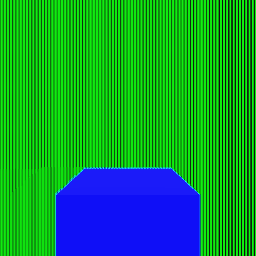
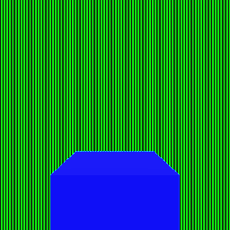
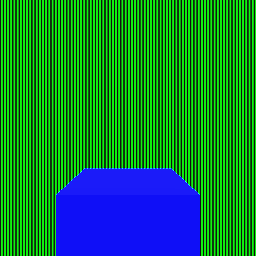

# Rendering regression validation

These synthetic scenes isolate temporal detail and opening-edge rejection. They are renderer
regressions, not a claim of photographic scene quality. The images come from the native renderer.

## Fast camera

A tracked subject travels with the camera while a striped roadside wall crosses the screen at
more than 32 pixels per frame. The camera stays below the global camera-cut threshold. The
reference uses the same final view and jitter phase without accumulated history.

| Previous resolve | Updated resolve | Fresh reference |
| --- | --- | --- |
|  |  |  |

The mean sum of absolute RGB byte differences per pixel in the wall region was 41.1073 with
the previous shader. The updated resolve meets the regression threshold of 0.5, with both zero
and four MSAA samples. Temporal antialiasing disabled produces the same final pixels as a fresh
view. Existing static and slowly moving foliage tests still pass.

## Opening edge

A foreground card moves about 7.7 pixels while its background moves about 1.6 pixels. Both
remain below the fast-motion threshold. The regression selects 51 freshly revealed black pixels
next to the card. Their mean sum of absolute RGB byte errors falls from 588 to zero.

| Previous resolve | Updated resolve |
| --- | --- |
|  |  |

The previous shader fails both regressions. These original controls isolate current motion and
neighbor disagreement; the additional depth validation below covers surfaces that disappear
without leaving a motion discontinuity. Fine moving detail can still trade smear for shimmer.

## Particle shadows and water refactoring

Particle render tests distinguish receiver darkening from the visible sprite, compare circular
and rectangular silhouettes, check transparent flipbook cells and lifetime alpha, clear expired
casters, and require identical disabled frames before and after an enabled frame.

The water shader is divided into small helpers for intersection, reflection, lighting,
transmission, foam and composition. Each function body is at most 13 lines. All 28 water
regression images remain pixel-identical across this refactoring. Across existing non-temporal
scenes, 83 shared screenshots remain pixel-identical to the earlier renderer.

## Validation environment

On a GeForce RTX 4050 Laptop GPU, the combined change passed 1,193 C++ unit/integration cases
(41,877 assertions), 23 Ruby suites and 52 render cases (655,490 assertions). Include-direction
checks pass. The lit, depth, motion, particle-shadow and temporal programs also compile and link
as GLSL ES 3.00 through native Mesa Intel EGL. This is not Android-device validation.

With 60 warm-up frames and 600 measured frames at 1600 x 900, without vertical synchronization,
the scatter field measured 3.107 ms average / 3.106 ms median and the local showcase scene
5.091 ms average / 5.075 ms median. These are measurements of this run, not a controlled claim
of speedup over another revision. Showcase assets are local and are not included here.

## Previous-frame depth validation

The temporal history stores logarithmic view distance in its existing alpha channel. The motion
pass stores the expected previous view distance alongside its velocity, using the previous object
and bone transforms. Color history is read where the surface was, without either frame's
Halton shift: the history is the average over every shift, so a still view holds still. Only
the depth lookup accounts for the current and previous shifts, because each stored depth is the
previous frame's jittered sample. Depth is checked over the reprojected texel and its eight
neighbors: one match keeps the history (the previous sample may have landed one texel over at a
silhouette, against the sky or another surface), none rejects it. Where only some match (a depth
edge), the filtered color is kept within the four nearest texels' colors, so the spline's outer
taps add no color from across the edge. An uninitialized frame cannot
accumulate history; its output still initializes depth for the next frame. Sky (any depth below a
small threshold) and points behind the previous camera have distinct markers. Deliberately stochastic coverage (distance fades
and dithered transparency) has signed depth metadata, allowing covered samples and sky holes
to accumulate. An opaque center pixel still requires its own depth match; a neighboring
stochastic surface cannot make unrelated opaque history valid.

Logarithmic distance avoids overflowing half-float channels for distant geometry. A bounded
comparison margin allows half-float rounding and the depth change across a subpixel footprint;
it cannot grow without limit at a silhouette. The existing targets and render passes are reused.
The first temporal frame now also draws the motion pass so its depth history starts initialized.

Isolated resolve tests distinguish depth rejection from color clipping and velocity rejection.
They cover zero-motion disocclusion, expected previous depth, invalid history, sky, jittered depth
edges, colors beside a depth edge and distant values. Scene regressions additionally exercise a stopped foreground object
that disappears and approaching rigid and skinned geometry, with zero and four MSAA samples.
The approaching surfaces use dithered coverage so discarding all history cannot pass as a fix.
A still, turned cube in front of the sky and of a wall checks that the settled picture changes by
less than 0.7 bytes per cube pixel from frame to frame (about 6 when the color lookup followed
the jitter, about 1 when history was rejected at every silhouette) and that its silhouette
gains partly covered pixels over a single sample.

The opaque-neighbor control selects 51 newly revealed black edge pixels beside a surviving
white surface. With four MSAA samples, the previous renderer retains a mean sum of absolute RGB
byte errors of 732; depth validation reduces that selected-edge error to zero. This does not
claim that every pixel in an accumulated frame matches a fresh frame. Both renderers produce
pixel-identical fresh reference pictures.

| Previous history | Previous-depth validation |
| --- | --- |
|  |  |

The crops cover [124, 100, 138, 156] in the original 256 by 256 picture and are enlarged eight
times with nearest-neighbor sampling. The previous result retains a bright column from the
removed opaque card. The corrected edge agrees with the freshly rendered background.

The combined render suite passes 97 cases and 655778 assertions; the full unit suite passes
1215 cases and 42068 assertions. The thirteen new depth/scene cases also pass on llvmpipe.
The previous renderer fails eight of ten isolated depth cases
and both disappearing-object scene cases (six failed assertions). The approaching rigid/skinned
scene remains a positive history-preservation control. Five native GLES shader pairs compile
and link; this does not replace Android packaging.

A render-only ABBA comparison uses temporal anti-aliasing in both versions, a fixed 0.5-second
animation clock, 1600 by 900 pixels, 60 warmup frames and 600 measured frames. The baseline uses
the same twelve-wave water detail as the candidate. Physical interaction detection and game
logic are excluded.

| Scene | Previous medians (ms) | Depth-validation medians (ms) | Pair averages (ms) |
| --- | --- | --- | --- |
| Scatter field | 3.913, 3.846 | 3.876, 3.844 | 3.880 to 3.860 |
| Coastal water | 12.573, 12.664 | 12.659, 12.675 | 12.619 to 12.667 |

These small differences are comparable to repeat variation; they do not establish a speedup
or a precise overhead. The added motion pass on the first temporal frame is outside the warmed
measurement. No additional history texture or steady-state render pass is allocated.
