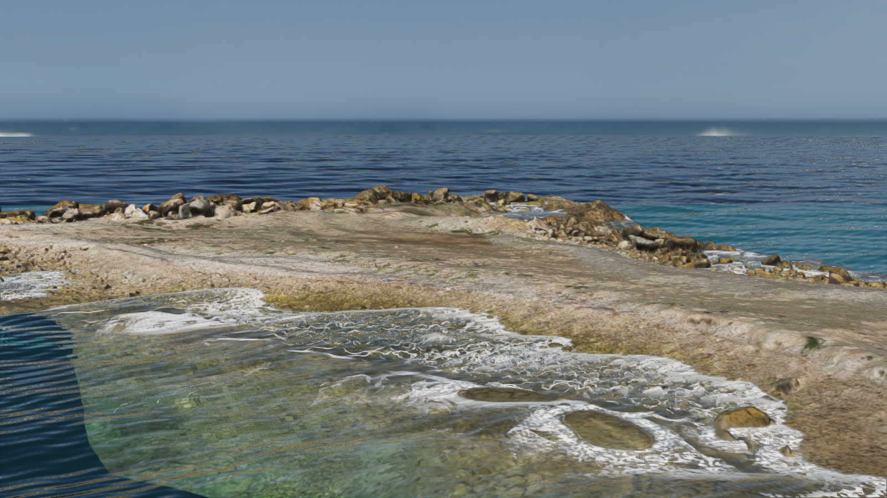
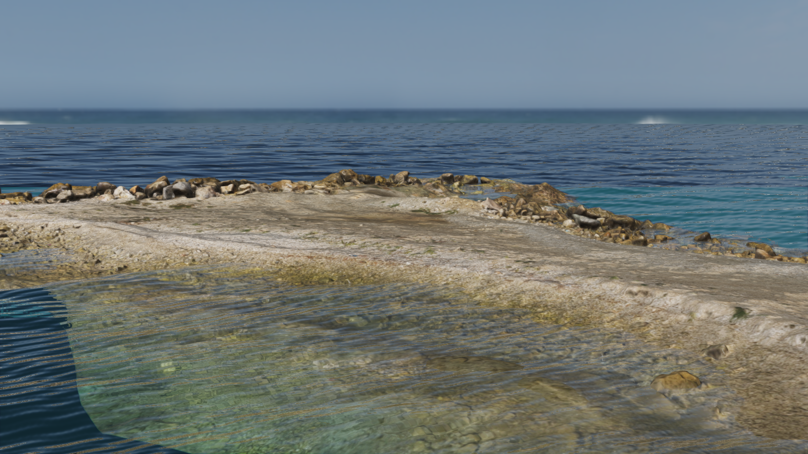
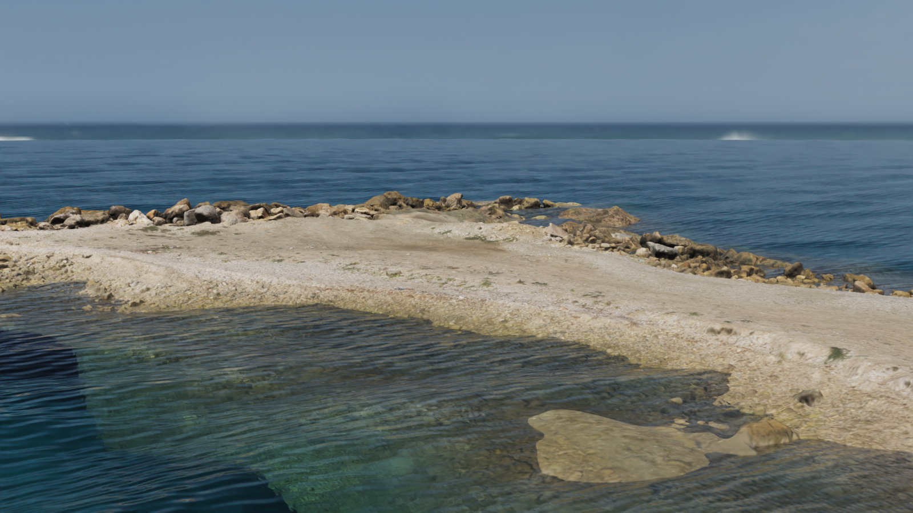

# Coastal water validation

Photorealistic acceptance remains open. Geometric refraction controls pass and shore foam now
follows a local horizontal band, but the coastal study still shows overly regular distant reflections.
The current filtered-normal roughness approximation needs further validation against integrated
shading. Passing geometric and temporal controls does not establish a photographic result.

## Horizontal shore band

Optical path length previously placed foam across broad shallow terraces. The band now uses
the horizontal distance to the intersection of visible bottom and water tangent planes.
`foam_width` is a horizontal width in meters, with 15 percent spatial reach variation.
Parallel shallow plateaus receive no foam. Centimeter pores fade to their expected mean
coverage when unresolved; even dense coverage retains at least 28 percent of the transmitted light.

This is a local screen-space estimate, not a complete shoreline field. Discontinuous or
missing depth suppresses coverage; curved terrain can produce gaps or differ from the nearest
shore. The pattern is stationary and has no advection, accumulation or breaking-wave simulation.

Physical controls require support inside 0.5 meters and none beyond 1.25 meters for a nominal
one-meter band, across three bottom slopes and two camera angles. Separate controls cover a
sloping water surface over flat ground, a vertical wall and a shallow plateau without a shore.
Close-up pores retain the original minimum counts and transmission requirement. A separate
frequency probe rejects decimeter clouds; minified coverage agrees with a resolved area quadrature.

The complete updated render suite passes 83 cases and 655739 assertions. The ten initial foam
cases also pass on NVIDIA and llvmpipe. The two additional geometry controls pass on both renderers.
The new helpers received an independent correctness review; this does not establish photographic acceptance.

Restoring optical-path coverage and decimeter pores makes all five selected negative controls fail:
the flat plateau gains roughly 50000 changed pixels, the visible band edge moves by 0.5 to
0.8 meters across slope/camera changes, and the fine-pore probe finds only 31 crossings instead
of the required 100. These controls retain the same geometric and frequency thresholds.

## Historical optical study

Both views use the same scanned coast, camera, sun, sky, seven-component wave field and
0.5-second clock at 1600 by 900 pixels. Foam is disabled in both optical views. Exposure is
0.8 with the same display transform; there is no alignment or exposure fitting.
The reference uses Cycles with 32 samples, denoising, IOR 1.333, roughness 0.07 and the same
absorption coefficients. Its isotropic volume scattering is a physical approximation of the
runtime body-light term; atmospheric fog and derivative filtering do not have identical models.
The micro-height field is represented by bump shading in the reference.
The reference's macro normals come from the displaced radial mesh, while the runtime uses
analytic gradients. At a radius of 100 meters its radial and tangential edges are about
1.58 and 1.64 meters, exceeding the shortest macro wavelength of 0.90 meters. Distant normal
convergence must therefore be checked before attributing the image difference to shading alone.

| Runtime | Cycles reference |
| --- | --- |
|  |  |

The finite scan ends above a separate deeper substrate. Both pictures show that geometric
edge; it must be distinguished from duplicated or displaced refraction samples.

Fixed rectangles exclude the shore and sky. Coordinates are `[left, top, right, bottom]` in
original pixels. MAE is the mean absolute RGB byte difference. SSIM uses an 11-pixel Gaussian
window with sigma 1.5, population covariance, constants 0.01 and 0.03, and a five-pixel border
removed from the result. Values below are computed from the lossless pictures above.

| Region | Rectangle | RGB MAE | RGB SSIM |
| --- | --- | ---: | ---: |
| Distant water | [40, 260, 1560, 325] | 13.797 | 0.3061 |
| Foreground water | [200, 740, 1350, 880] | 28.880 | 0.4300 |

A seven-wave preview without the new unresolved micro-normal variance measured 12.073 MAE /
0.4081 SSIM in the distant rectangle. The current approximation regresses that comparison;
its reflection filtering remains under investigation before visual acceptance.

## Correctness controls

- Isolate screen-space reflection from transmission using submerged and exposed emissive objects.
- Compare transmitted silhouettes with an independent CPU Snell-law intersection, including
  supported interior coverage and false copies outside the postprocess footprint.
- Compare absorption outside a partially exposed object's silhouette against the identical
  unobstructed flat or inclined floor.
- Reproduce a missed inclined-depth root when search and refinement use different samplers.
- Require a soft, irregular foam band, open water pockets and partial bottom transmission.
- Check displacement bounds, analytic gradients, stationary clocks and filtered normal energy.

The full render suite passed 76 cases and 655593 assertions. Unit checks passed 1215 cases
and 42068 assertions. Local shader-validation binaries rebuild shader construction and changed
tests while reusing unchanged CPU libraries. Clean builds remain a CI requirement.
The actual GLES shader pairs for lighting, motion, depth, particle shadows and temporal resolve
all compiled and linked on a native GLES context. This does not replace an Android package build.

Negative controls remove micro-normal variance or restore the continuous foam coverage floor:
they respectively lose energy at 4608 distant probe pixels and produce no open pockets in
1089 shallow-shelf samples. Restoring nearest-depth bracketing makes the inclined-root probe
return the wrong sample coordinate. The corrected versions pass those checks.

## Smooth specular normalization

The direct-light GGX distribution now preserves narrow specular lobes. Its previous additive
denominator floor suppressed their energy: at roughness 0.07, the analytic peak is about
13257, while the floored expression returned 0.24. The equivalent positive denominator is
evaluated without that floor; callers already bound perceptual roughness to at least 0.045.
This intentionally affects direct specular lighting on all materials, including water.
It does not change the sky prefilter or establish agreement with the coastal reference.

A GPU probe checks the production distribution against an independent double-precision
reference at roughness 0.045, 0.07, 0.15 and 0.4, using 512 projected-distribution samples each.
Both peak and projected mass checks pass on NVIDIA and software rendering. Restoring the
old denominator fails all eight peak/mass checks. Foam envelope checks average 21 shoreline
profiles so individual pores cannot determine band width; the existing width, softness and
independent porosity requirements remain unchanged.
The updated full render suite passes 77 cases and 655602 assertions; formatting and C++ lint
also pass. The correction received a separate correctness review before publication.

The optical-study pictures, optical metrics and frame times below precede this normalization
correction and the horizontal shore band. They remain historical evidence. The shore-band picture
above uses both corrections.

## Shore-band cost

With the same RTX 4050 Laptop GPU, 1600 by 900 image, 0.5-second clock, 60 warmup frames and
600 measured frames, a separate ABBA comparison isolates the horizontal shore band from
the preceding normalized-specular version. Physical interaction detection and game logic are excluded.

| Version | Run medians (ms) | Mean of medians (ms) |
| --- | --- | ---: |
| Optical-path foam | 11.489, 11.585 | 11.537 |
| Horizontal shore band | 11.695, 11.735 | 11.715 |

The new band adds about 0.18 ms, or 1.5 percent, in this coastal view.

## Historical combined cost

RTX 4050 Laptop GPU, 1600 by 900, clock 0.5, 60 warmup frames and 600 measured frames per run.
One process runs at a time. Order is baseline, candidate, candidate, baseline.
These are render-only frame times; physical interaction detection and game logic are excluded.

| Version | Run medians (ms) | Mean of medians (ms) |
| --- | --- | ---: |
| Main baseline | 9.812, 9.898 | 9.855 |
| Water changes | 11.443, 11.520 | 11.482 |

This scene costs about 1.63 ms more, or 16.5 percent. The measurement includes the changed
wave field, normal filtering, refraction and procedural foam together.

## Assets

The local study uses [Coast Rocks 01](https://polyhaven.com/a/coast_rocks_01), by Rico Cilliers
and Rob Tuytel, and [Ballito Rocky Beach](https://polyhaven.com/a/ballito_rocky_beach), from
Poly Haven under CC0. Only rendered validation pictures are included here; source assets and
the demonstration project remain local.
