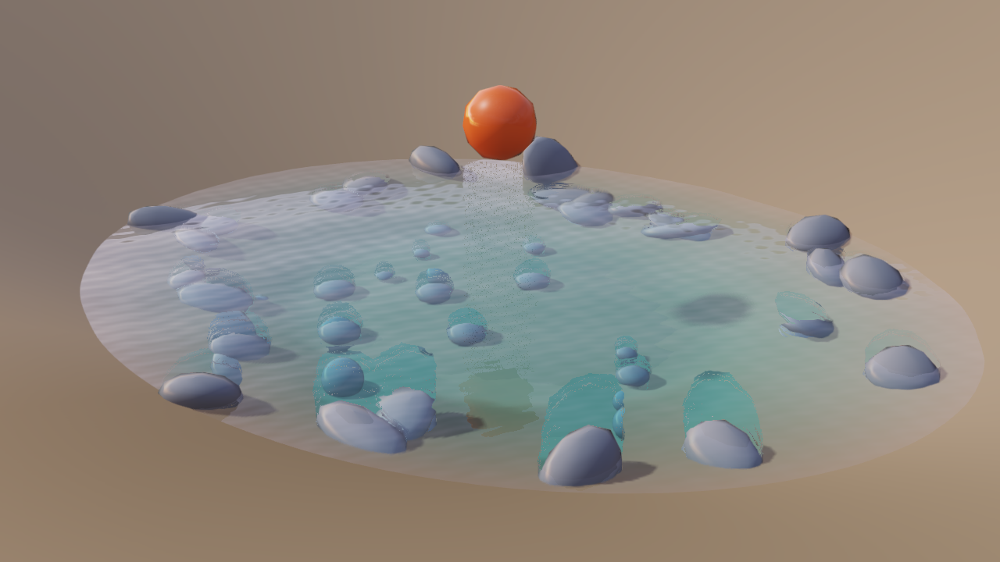
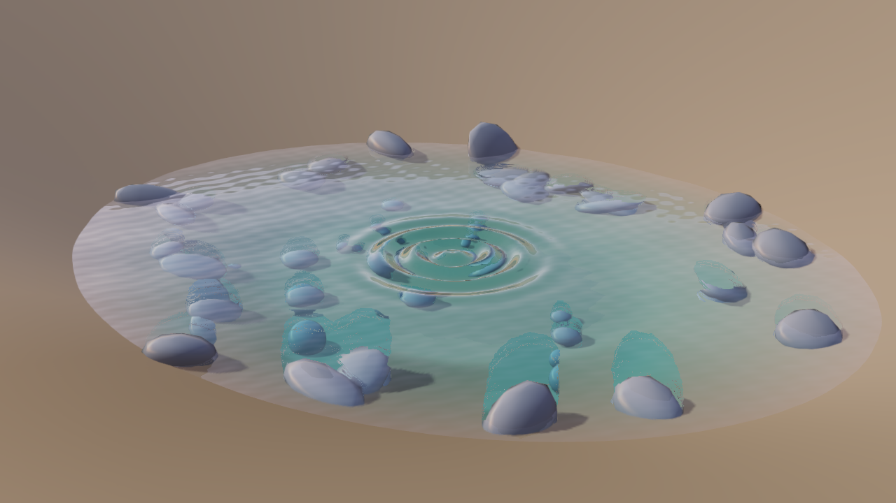
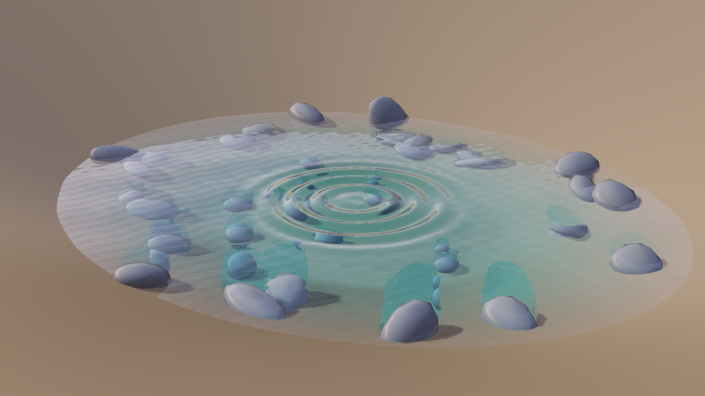

# Water interaction validation

Physical bodies generate local water impulses automatically. Entry, exit and motion along the
surface produce radial packets with finite lifetimes. Detection uses conservative collider
bounds against the rendered water triangles, with a cached spatial index. The water mesh needs
no collider. Impulses belong to one object and original primitive, even when meshes and materials
are shared. See [Water surfaces](levels.md#water-surfaces) for supported geometry and limits.

## Native impact study

A dynamic stone falls into a procedural pond. The game script contains no effect or splash call;
physics and water interaction detection produce the waves. The native test captures the scene
before entry, at impact and during propagation.

| Before entry | Impact | Propagation |
| --- | --- | --- |
|  |  |  |

This is a functional study with placeholder materials. Optical artifacts around submerged edges
remain under investigation. Fluid simulation, buoyancy, splashes, breaking waves and network
replication of impulses remain unsupported.

## Correctness and code review

The regression suite covers fast swept crossings, entry/exit and wakes, dry materials, holes,
shared meshes/primitives, geometry caching, stationary jitter, destroyed handles, teleports,
kinematic movement from scripts, pause, expiry and world replacement. Living bodies can visit
more than the retained-contact budget without permanently exhausting it.

Contacts retain their wet-state hysteresis and cooldown through small oscillations inside the
surface band. Exit impulses use the final contact at the shoreline or along an upward path,
rather than the body's position before leaving. Dedicated regressions reproduce both failures
against the preceding detector.

Rendering tests check owner isolation, canonical simulation ages, repeated drawing, public
snapshot validation, previous-frame packets, expiration, asset reload and temporal antialiasing
with zero/four MSAA samples. Rendering never advances the simulation. The previous packet comes
from the last frame actually drawn. Empty snapshots preserve the existing draw path.

The complete build passed 1,212 C++ cases (42,022 assertions), 23 Ruby suites and 60 native render
cases (655,534 assertions). All 1,509 checked include directions are allowed. A comparison with
the preceding renderer found 106 shared screenshots pixel-identical; three grass images use a
real-time wind clock and differ between runs. The lit, depth, motion, temporal and particle-shadow
programs also compile and link as GLSL ES 3.00 through native Mesa Intel EGL. Phone hardware has
not been tested.

New C++ methods pass the project's size and complexity limits. The water shader uses small
helpers for propagation, gradients, intersections, lighting and composition.

## Frame time

GeForce RTX 4050 Laptop GPU, 1600 x 900, fixed render clock, vertical synchronization disabled,
60 warm-up frames and 600 measured frames:

| Pond render mode | Mean | Median |
| --- | ---: | ---: |
| No impulses | 4.967 ms | 4.926 ms |
| One impulse | 5.091 ms | 5.110 ms |
| Sixteen impulses | 5.593 ms | 5.615 ms |

These modes measure rendering, excluding the CPU contact detector. The impulses have fixed ages,
so simulation changes do not confound the comparison.

In alternating comparisons without active impulses, the preceding field renderer measured
3.631/3.740 ms median and this renderer 3.463/3.533 ms. The local showcase measured 6.388 ms
before and 6.414 ms after. Earlier isolated runs varied with machine power and thermal state;
these results do not establish a speedup. Local showcase assets are not included.
