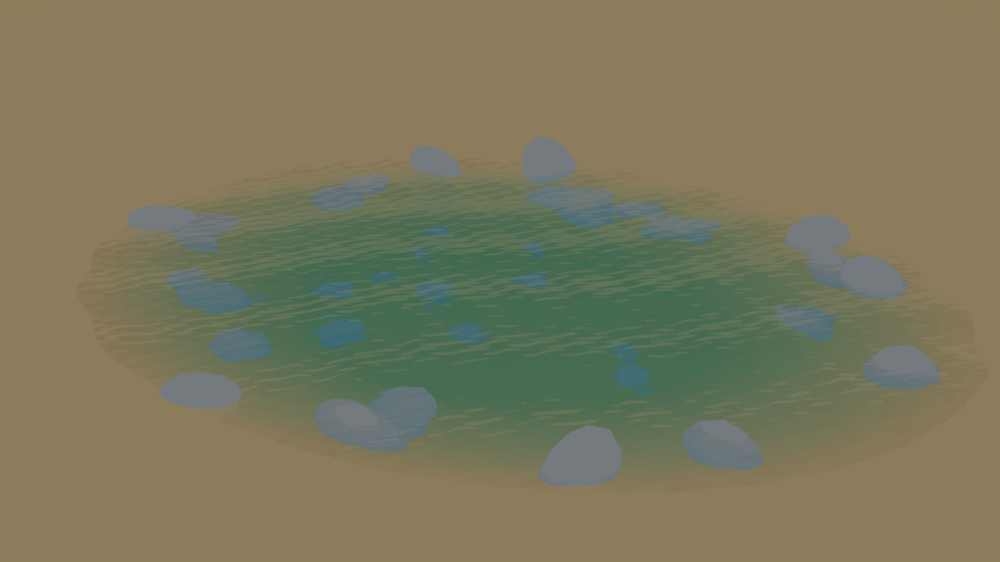
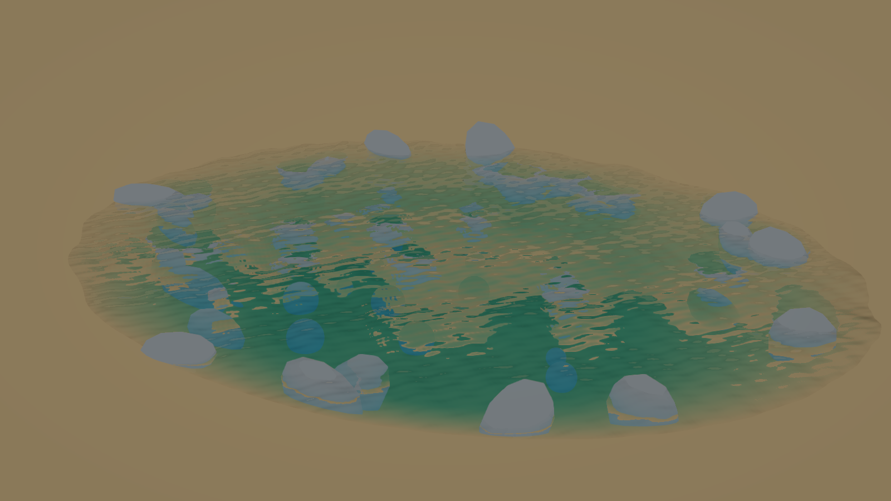
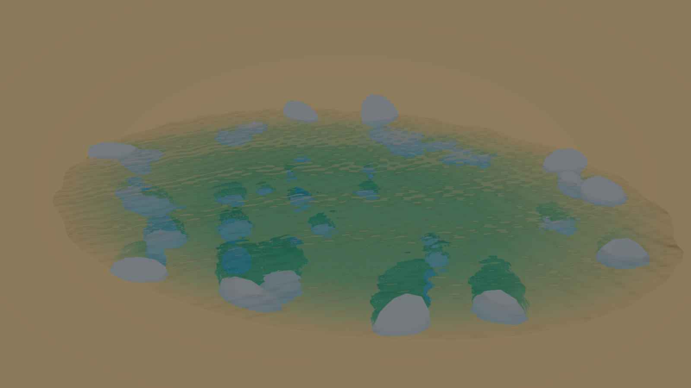

# Water optical comparison

This fixed-camera study isolates refraction and absorption from incident lighting. The bottom
and stones emit their own color; the sun and environment are black, and water has no body color.
The reference uses Cycles with a transmitting surface and an absorption volume. Geometry, camera,
wave phase, small ripple height field, absorption coefficients and display curve are matched.
All scene geometry was created for this study; no vehicle or production-scene assets are included.

The images are 1600 × 900, with the wave clock fixed at 0.5 seconds. Water has a maximum wave
height of 0.045 m, dominant wavelength of 2.3 m, roughness of 0.065, IOR of 1.333 and absorption
coefficients (0.42, 0.07, 0.035) per meter. Shore foam is disabled. The display uses exposure 0.8,
the runtime's ACES fit and gamma 2.2. The Cycles reference uses 64 samples and denoising.

| Runtime refraction | SSIM against reference | Mean absolute RGB error |
| --- | ---: | ---: |
| One projected depth estimate | 0.9210 | 0.02019 |
| Bounded depth intersection with filtered depth | 0.9479 | 0.01057 |

RGB error is measured on display values normalized to [0, 1]. SSIM uses an 11-pixel Gaussian
window with sigma 1.5. The newer implementation reduces mean error by about 48% in this control.
This measures an optical improvement, not completion of the visual-quality target.

## Reference

## Before

## After

Screen-space refraction cannot recover hidden or off-screen geometry. A failed intersection
keeps the undistorted opaque sample; differences remain around occlusion boundaries. The runtime
also uses a different reflection and sampling approximation from the offline reference.

A separate study with a lit bottom remains less accurate: water attenuates the bottom-to-camera
path, but not incident illumination on submerged geometry. That approximation is recorded in
the known limitations and must be addressed separately; these control images do not remove it.
